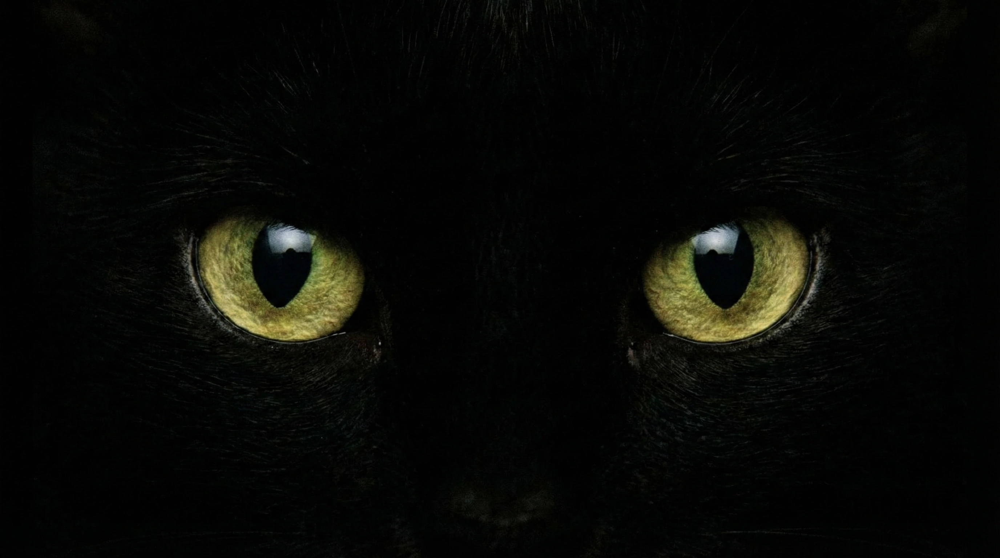
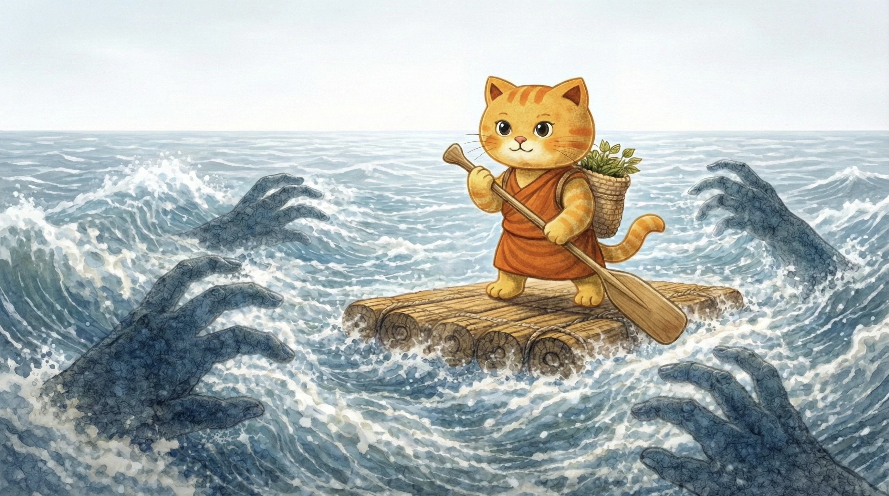
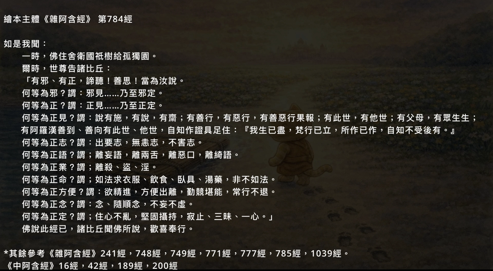

## 全片分鏡｜依影片順序

狀態：逆向分鏡初稿，供繪本改編與素材核對。依使用者提供的《我的影片 5-360p30.mov》（約10:32.5、640×360）、11張圖像及1張經典截圖整理。沿用前作的「時間碼 → 原圖 → 網頁畫面與疊字 → 上緣字幕 → 下緣經文」格式。

<b>時間碼為抽樣定位約值，可能有數秒誤差，尚未逐格定點。</b> 以下110條為字幕整理稿，標點、牠／他已做閱讀性統一，並非旁白音軌逐字聽打；少量快速轉場字幕可能仍待補核。經文依影片與截圖記錄，省略處明列為節錄，尚未逐句比對原典。原影片文案與建議校訂分開保存。

### 全片索引

| 幕 | 約略時間 | 畫面／主題 | 字幕條數 |
| --- | --- | --- | --- |
| 01 | 00:00–00:08 | 片頭｜黑暗中摸索 | 1 |
| 02 | 00:08–00:58 | 正見｜看清地圖 | 10 |
| 03 | 00:58–01:57 | 正志｜校正羅盤 | 10 |
| 04 | 01:57–02:55 | 反例｜惡行使心不安 | 10 |
| 05 | 02:55–03:53 | 正語｜慚愧與誠實 | 8 |
| 06 | 03:53–04:42 | 正業｜不偷盜、不殺生與無悔 | 8 |
| 07 | 04:42–05:00 | 正業｜不邪淫 | 3 |
| 08 | 05:00–05:49 | 正命｜清淨的生活所需 | 9 |
| 09 | 05:49–06:59 | 正方便／正精進｜逆流划槳 | 13 |
| 10 | 06:59–08:14 | 正念｜記得方向、看清浪頭 | 14 |
| 11 | 08:14–09:14 | 正定｜澄澈水面 | 11 |
| 12 | 09:14–10:13 | 抵岸｜筏喻與等捨 | 11 |
| 13 | 10:13–10:32 | 總結與經典出處 | 2 |

### 原圖核對與製作原則

- 已收到：黑貓眼睛、正見地圖、正志羅盤、惡行四格、善行四格、正命交換、正精進划槳、正念巨浪、正定月夜、天鵝伴侶、抵岸捨筏，共11張圖像；另有片尾經典截圖。
- 尚缺貓群標題封面原圖，目前以影片截圖定位。
- 正志圖已換成使用者提供的高清重繪版本 6AAA9E3B-5560-446C-921E-F83C498154DC.jpeg，正式繪本使用此版本。
- 善行四格同時服務正語、正業及無悔段落，不需要另畫一張來重複相同故事。
- 畫面維持16:9、童書手繪與同一橘貓；上緣白話字幕、下緣經文分開重建為可選取文字。原圖已有的木牌文字與警告標誌不再重複疊字。
- 同一畫面切換字幕或經文時，繪本可拆為多頁；不要把整段字幕一次堆在圖片上。

## 逐幕圖文與疊字

### 01｜片頭｜黑暗中摸索｜約00:00–00:08

<b>網頁畫面</b>　黑貓雙眼特寫。原圖無字；片頭另有貓群標題封面，需截圖定位。

| 約略起訖 | 上緣字幕整理稿 |
| --- | --- |
| 00:00–00:08 | 在太陽還沒出來之前，我們習慣在黑暗中摸索，以為我們所認知的就是真實。 |

<b>下緣經文／出處（影片轉錄或節錄，待原典校核）</b>

片頭未列經文。

### 02｜正見｜看清地圖｜約00:08–00:58

<b>網頁畫面</b>　左側白字：八正道：正見／十善業道：正見。上緣黑字、下緣白字。

| 約略起訖 | 上緣字幕整理稿 |
| --- | --- |
| 00:08–00:14 | 陽光灑下，小貓終於看清了手中這張名為「正見」的地圖。 |
| 00:14–00:18 | 表面上，這張地圖標示著「哪裡安全，哪裡危險」。 |
| 00:18–00:24 | 它告訴我們：相信布施與善行是有價值的，相信善惡都有回報； |
| 00:24–00:30 | 相信有前世與來世，相信父母有養育之恩； |
| 00:30–00:35 | 並且相信，這世上真有修行證悟的阿羅漢，已經徹底超越了輪迴的苦。 |
| 00:35–00:40 | 但這還不夠，「正見」地圖還有更深層的指引。 |
| 00:40–00:45 | 要渡過眼前這條生老病死的「生死之流」， |
| 00:45–00:50 | 我們需要看透「苦」的真相，以及煩惱止息的路徑。 |
| 00:50–00:54 | 只有看懂了這條隱藏的路線， |
| 00:54–00:58 | 我們才能從不停打轉的岸邊，真正出發，前往安穩的彼岸。 |

<b>下緣經文／出處（影片轉錄或節錄，待原典校核）</b>

《雜阿含經》748：如日出前相，謂明相初光。如是比丘正盡苦邊，究竟苦邊前相者，所謂正見。 《雜阿含經》784：何等為正見？謂說有施、有說、有齋；有善行、有惡行、有善惡行果報；有此世、有他世、有父母、有眾生生；有阿羅漢善到、善向……。 《雜阿含經》785：正見是聖、出世間、無漏、不取、正盡苦、轉向苦邊；於苦、集、滅、道思惟，與無漏思惟相應。（此處為節錄，完整字句待原典校核。）

### 03｜正志｜校正羅盤｜約00:58–01:57

<b>網頁畫面</b>　白字：八正道：正志／十善業道：不貪，不瞋恚。毒花、警告牌、羅盤與鐵槍已在圖內。已換上使用者提供的高清重繪圖。

| 約略起訖 | 上緣字幕整理稿 |
| --- | --- |
| 00:59–01:04 | 有了地圖，我們還需要一個不受干擾的羅盤。 |
| 01:04–01:09 | 過去，我們心裡的指針總是瘋狂亂轉。 |
| 01:09–01:17 | 一下倒向「貪婪」，想抓取喜歡的；一下偏向「憤怒」，想推開討厭的。 |
| 01:17–01:22 | 為了讓混亂停下來，小貓想起了佛陀沉重的叮嚀： |
| 01:22–01:29 | 「寧可眼睛被燒熱的鐵槍刺中，也不要被慾望的畫面勾走。」 |
| 01:29–01:35 | 抱著這份如鐵槍般堅定的決心，小貓終於將指針校正回三個安全的方向： |
| 01:35–01:40 | 第一是「離欲」，學會鬆開手，不再執著一定要擁有。 |
| 01:40–01:45 | 第二是「不生氣」，把心裡的刺拔掉，不再懷抱敵意。 |
| 01:45–01:50 | 第三是「不害」，溫柔對待每一個生命，不造成傷害。 |
| 01:50–01:57 | 當指針不再搖擺，我們就能順著真理的水流，穿越煩惱，直達彼岸。 |

<b>下緣經文／出處（影片轉錄或節錄，待原典校核）</b>

《雜阿含經》784：何等為正志？謂出要志、無恚志、不害志。 影片亦出現《雜阿含經》1039（不貪、不瞋恚相關節錄）及241（眼根與欲境警策）；241完整引句尚待核對，不以故事改寫冒充原文。

### 04｜反例｜惡行使心不安｜約01:57–02:55

<b>網頁畫面</b>　保留四格。依段落疊字：十惡業：偷盜／殺生／妄語／心不定；正式製作前逐格確認出現順序。禁止砍伐牌已在原圖。

| 約略起訖 | 上緣字幕整理稿 |
| --- | --- |
| 01:57–02:04 | 但是，森林裡總是充滿誘惑。有時候，我們為了求快， |
| 02:04–02:09 | 會想：「稍微違規一下應該沒關係？」 |
| 02:09–02:15 | 於是，小貓偷偷砍了不該砍的樹，卻意外摔碎了無辜的鳥蛋。 |
| 02:15–02:21 | 當守護者來問話時，為了保護自己，小貓把斧頭藏在背後，說了謊話。 |
| 02:21–02:27 | 雖然木筏好像很快就造好了，但當晚，小貓卻睡不著了。 |
| 02:27–02:34 | 破碎的蛋、說謊的恐懼，變成了惡夢，在心裡吵個不停。 |
| 02:34–02:40 | 佛陀說：我們之所以要守規矩，不是為了討好誰，而是為了「沒有後悔」。 |
| 02:40–02:45 | 一旦心裡有了疙瘩，快樂就進不來，心也靜不下來。 |
| 02:45–02:50 | 漏水的船，是無法在風浪中保持穩定的。 |
| 02:50–02:55 | 這就是為什麼，想要前往彼岸，我們必須先修補這些行為的破洞。 |

<b>下緣經文／出處（影片轉錄或節錄，待原典校核）</b>

《雜阿含經》1039：何等為黑、黑報、不淨、不淨果……殺生、偷盜相關節錄。 《中阿含經》189：正見者能起正志，正志能起正語，正語能起正業，正業能起正命，正命能起正方便，正方便能起正念，正念能起正定。

### 05｜正語｜慚愧與誠實｜約02:55–03:53

<b>網頁畫面</b>　沿用善行四格，先聚焦左上道歉。疊字：八正道：正語／十善業道：不妄語，不兩舌，不惡口，不綺語。

| 約略起訖 | 上緣字幕整理稿 |
| --- | --- |
| 02:55–03:04 | 當太陽升起，光線照進了心裡，小貓看見了昨晚做的惡夢，感到一陣慚愧。 |
| 03:04–03:13 | 這份羞恥心像是一場及時雨，洗去了貪婪的衝動。於是，小貓決定重新開始。 |
| 03:13–03:20 | 牠鼓起勇氣，走向黑熊守護者，深深鞠躬說：「對不起，昨天是我說謊了。」 |
| 03:20–03:25 | 這是「正語」中的不妄語，誠實讓心裡的石頭放下了。 |
| 03:25–03:32 | 小貓終於明白，語言是用來連結彼此的橋樑，而不是傷害的武器。 |
| 03:32–03:39 | 因此，牠在心裡許下了四個約定：不妄語，不說謊話欺騙別人； |
| 03:39–03:45 | 不兩舌，不說壞話挑撥感情；不惡口，不說粗話刺傷人心； |
| 03:45–03:53 | 不綺語，不說沒有意義的廢話浪費時間。只說溫暖、真實且有用的話。 |

<b>下緣經文／出處（影片轉錄或節錄，待原典校核）</b>

《雜阿含經》749：若起明為前相，生諸善法，時慚愧隨生。慚愧生已，能生正見；正見生已，起正志、正語、正業、正命、正方便、正念、正定，次第而起。 《雜阿含經》784：何等為正語？謂離妄語、離兩舌、離惡口、離綺語。

### 06｜正業｜不偷盜、不殺生與無悔｜約03:53–04:42

<b>網頁畫面</b>　沿用同張四格，依序聚焦右上漂流木、左下護蟲、右下安睡。切換疊字：正業／不偷盜／不殺生。

| 約略起訖 | 上緣字幕整理稿 |
| --- | --- |
| 03:53–04:00 | 接著，牠回到河邊。這一次，牠不再砍樹。只撿拾地上允許取用的漂流木， |
| 04:00–04:06 | 尊重森林的給予。這是正業中的「不偷盜」。 |
| 04:06–04:13 | 當牠發現木頭上有隻小蟲時，牠輕輕地把蟲移到安全的草地上。 |
| 04:13–04:18 | 這是正業中的「不殺生」，也是對生命的溫柔。 |
| 04:18–04:25 | 那一天晚上，小貓躺在修好的木筏上，睡得好香好甜。沒有惡夢。 |
| 04:25–04:29 | 佛陀告訴伽藍人一個秘密：做好事，不是為了討好神， |
| 04:29–04:35 | 而是為了現在就活得安心。因為行為乾淨了，心就不會後悔。 |
| 04:35–04:42 | 名為「無悔」的木筏，才能載著我們，平穩地航向安靜的水域。 |

<b>下緣經文／出處（影片轉錄或節錄，待原典校核）</b>

《雜阿含經》1039：有人不殺生、離殺生、捨刀杖，慚愧、悲念一切眾生。不偷盜、遠離偷盜，與者取、不與不取，淨心不貪。（影片節錄） 《中阿含經》16：若有所作，必不作惡……是謂得第四安隱住處。（影片節錄，完整引句待校核）

### 07｜正業｜不邪淫｜約04:42–05:00

<b>網頁畫面</b>　小貓抱木頭經過天鵝伴侶。白字：八正道：正業／十善業道：不邪淫。

| 約略起訖 | 上緣字幕整理稿 |
| --- | --- |
| 04:42–04:49 | 同時，小貓學會了尊重界線。看見森林裡其他動物的伴侶與家庭， |
| 04:49–04:55 | 牠只是靜靜經過，絕不隨意干擾。這是正業中的「不邪淫」。 |
| 04:55–05:00 | 守護他人的承諾與親密關係，就是守護自己內心的純淨。 |

<b>下緣經文／出處（影片轉錄或節錄，待原典校核）</b>

《雜阿含經》1039：離於邪婬，若父母護，乃至授一花鬘者，悉不強干起於邪婬。（影片顯示文字，待原典校核）

### 08｜正命｜清淨的生活所需｜約05:00–05:49

<b>網頁畫面</b>　小貓持竹籃，與熊交換果實、藥草。白字：八正道：正命。

| 約略起訖 | 上緣字幕整理稿 |
| --- | --- |
| 05:00–05:07 | 木筏造好了，但渡河的旅程還很長，小貓需要維持體力。 |
| 05:07–05:12 | 這就是「正命」，選擇一種清淨的生存方式。 |
| 05:12–05:18 | 在這個森林裡，有些動物為了食物會去設陷阱、去搶奪。 |
| 05:18–05:24 | 但小貓記得地圖上的指引：「吃下不乾淨的食物，身體會生病； |
| 05:24–05:28 | 用傷害換來的糧食，心靈會沉重。」 |
| 05:28–05:34 | 於是，牠用誠實的勞動，換取剛好足夠的果實與藥草。 |
| 05:34–05:38 | 牠不貪心，也不囤積多餘的財寶。 |
| 05:38–05:42 | 佛陀說：「如法地獲取生活所需，守住慾望的界線。」 |
| 05:42–05:49 | 只有行囊是輕盈且乾淨的，我們才能在前往彼岸的風浪中，保持平衡，不會沉沒。 |

<b>下緣經文／出處（影片轉錄或節錄，待原典校核）</b>

《雜阿含經》784：何等為正命？謂如法求衣服、飲食、臥具、湯藥，非不如法。

### 09｜正方便／正精進｜逆流划槳｜約05:49–06:59

<b>網頁畫面</b>　小貓在風浪中奮力划槳。白字：八正道：正方便。

| 約略起訖 | 上緣字幕整理稿 |
| --- | --- |
| 05:49–05:55 | 木筏終於下水了，但小貓發現，河流的水流比想像中更急。 |
| 05:55–06:01 | 這條名為「輪迴」的大河，總是想把我們沖回下游， |
| 06:01–06:05 | 沖回那個充滿貪愛與黑暗的老地方。 |
| 06:05–06:10 | 這時候，我們需要「正方便」，也就是正確的努力。 |
| 06:10–06:15 | 過去，我們也很努力，忙著追逐快樂、忙著逃避痛苦， |
| 06:15–06:20 | 結果卻讓自己更累。這是世俗的有漏努力。 |
| 06:20–06:28 | 但現在，小貓的努力有了新的目標，「逆流而上」，這是出世間的無漏努力。 |
| 06:28–06:34 | 這需要一股持續不斷的力氣：看到前方漂來的惡念浮木，用力把它推開； |
| 06:34–06:38 | 看到乾淨的善念水道，奮力划過去。 |
| 06:38–06:45 | 這不是蠻力，而是一種「不讓心隨波逐流」的堅持。佛陀說：「常不休息。」 |
| 06:45–06:50 | 因為在湍急的生死流中，只要一停下來，我們就會後退。 |
| 06:50–06:55 | 只有握緊槳持續不斷地划，這股不想回頭的勇氣， |
| 06:55–06:59 | 終將帶我們穿越風浪，抵達彼岸。 |

<b>下緣經文／出處（影片轉錄或節錄，待原典校核）</b>

《雜阿含經》785：謂欲、精進、方便超出、堅固建立堪能造作、精進心法攝受、常不休息，是名正方便世、俗、有漏、有取，轉向善趣。 《雜阿含經》777：未生惡不善法令不生，已生惡不善法令滅，未生善法令生，已生善法重生令增廣。

### 10｜正念｜記得方向、看清浪頭｜約06:59–08:14

<b>網頁畫面</b>　小貓站穩木筏，周圍浪花化為巨手。白字：八正道：正念。

| 約略起訖 | 上緣字幕整理稿 |
| --- | --- |
| 06:59–07:05 | 船在逆流中前進，這時我們需要一位最清醒的守門人，叫做「正念」。 |
| 07:05–07:10 | 小貓站在船頭，睜大眼睛，時刻執行著兩項重要的任務。 |
| 07:10–07:18 | 第一項任務是「記得」（世俗正念）：記得手中的地圖，記得我們要去哪裡。 |
| 07:18–07:24 | 如果不小心分神了，就像那隻愛亂跑的猴子又想去抓路邊的樹枝， |
| 07:24–07:29 | 正念會溫柔地提醒：「嘿，回來！那不是我們要去的方向。」 |
| 07:29–07:32 | 第二項任務是「看清」（出世間正念）： |
| 07:32–07:37 | 這條河上隨時會打來名為「貪愛」與「憤怒」的巨浪。 |
| 07:37–07:42 | 如果沒有看清楚，我們很容易就被捲進水裡喝毒水。 |
| 07:42–07:48 | 但有了正念，小貓能清清楚楚地看著每一個浪頭打過來。 |
| 07:48–07:51 | 牠運用四聖諦的智慧看著浪花： |
| 07:51–07:56 | 「喔！這是一個生氣的浪（苦），是因為我不喜歡被潑溼（集）。」 |
| 07:56–08:01 | 因為看見了，所以不被捲走。牠不對浪花發脾氣， |
| 08:01–08:09 | 也不跳進水裡追逐浪花。只是穩穩地站著，讓浪頭從船邊流過。 |
| 08:09–08:14 | 這份清澈的覺知，守護著木筏，讓心在風浪中依然保持安穩。 |

<b>下緣經文／出處（影片轉錄或節錄，待原典校核）</b>

《雜阿含經》785：若念、隨念、重念、憶念、不妄不虛，是名正念世、俗、有漏有取，正向善趣。 同經：謂聖弟子苦苦思惟，集、滅、道道思惟，無漏思惟相應；若念、隨念、重念、憶念、不妄、不虛，是名正念是聖、出世間、無漏、不取、轉向苦邊。（影片轉錄）

### 11｜正定｜澄澈水面｜約08:14–09:14

<b>網頁畫面</b>　小貓俯身看水面倒影，月光與水面呼應。白字：八正道：正定。

| 約略起訖 | 上緣字幕整理稿 |
| --- | --- |
| 08:14–08:20 | 在經歷了「正方便」的奮力划槳，與「正念」的時刻守望之後， |
| 08:20–08:25 | 小貓終於來到了一片不可思議的水域。 |
| 08:25–08:30 | 這裡沒有風，也沒有浪。這就是「正定」。 |
| 08:30–08:36 | 過去，我們的心像是一杯混濁搖晃的水，什麼都看不清楚。 |
| 08:36–08:43 | 但現在，因為不再隨意抓取，也不再被情緒攪動，這杯水終於完全靜了下來。 |
| 08:43–08:48 | 小貓把心收攝回來，安住在這份深邃的寧靜裡。 |
| 08:48–08:52 | 這不僅是放鬆，更是一種極致的專注。 |
| 08:52–08:59 | 佛陀說：「因定，便得見如實。」就像眼前這片如鏡子般的水面， |
| 08:59–09:04 | 只有當波紋完全消失時，四聖諦的真理才能像天上的月亮， |
| 09:04–09:09 | 毫無扭曲地、完整地映照在我們心裡。 |
| 09:09–09:14 | 木筏終於載著小貓，在清澈的月光下，穩穩地靠向了彼岸。 |

<b>下緣經文／出處（影片轉錄或節錄，待原典校核）</b>

《雜阿含經》784：何等為正定？謂住心不亂，堅固攝持，寂止、三昧、一心。 《中阿含經》42：因定便得見如實、知如真；因見如實、知如真便得厭；因厭便得無欲；因無欲便得解脫。

### 12｜抵岸｜筏喻與等捨｜約09:14–10:13

<b>網頁畫面</b>　小貓已上岸，木筏留在水邊。左上方疊白字「等捨」。

| 約略起訖 | 上緣字幕整理稿 |
| --- | --- |
| 09:14–09:21 | 終於，木筏輕輕地觸碰到了對岸的沙灘。小貓抵達了安全的地方。 |
| 09:21–09:24 | 這時候，最後一個問題來了： |
| 09:24–09:30 | 這個陪伴我們度過驚濤駭浪的木筏，該如何處理呢？ |
| 09:30–09:33 | 是要把它背在背上，繼續趕路嗎？ |
| 09:33–09:41 | 不，那樣太沉重了。佛陀笑著說：「渡河是為了登岸，登岸後就該放下。」 |
| 09:41–09:46 | 於是，小貓回頭，對著木筏（八正道）深深地道謝。 |
| 09:46–09:51 | 感謝正見引路，感謝正定安神。但現在，是時候告別了。 |
| 09:51–09:56 | 小貓輕輕跳上岸，連同對「好」的執著也一起放下。 |
| 09:56–10:02 | 此刻的牠，兩手空空，卻擁有前所未有的自由。 |
| 10:02–10:08 | 這就是古仙人走過的最後一步：法尚應捨，何況非法？ |
| 10:08–10:13 | 在解脫的彼岸，沒有恐懼，沒有束縛，只有無限寬廣的安寧。 |

<b>下緣經文／出處（影片轉錄或節錄，待原典校核）</b>

《中阿含經》42：因定便得見如實、知如真……因無欲便得解脫。 《中阿含經》200：我為汝等長夜說筏喻法，欲令棄捨，不欲令受。若汝等知我長夜說筏喻法者，當以捨是法，況非法耶？

### 13｜總結與經典出處｜約10:13–10:32

（影片定位截圖保留於 Notion 原頁，非正式繪本素材。）

<b>網頁畫面</b>　片尾先列八正道與十善對照，再顯示784經及其餘參考經。需以文字重建，勿使用360p截圖作正式文字頁。

| 約略起訖 | 上緣字幕整理稿 |
| --- | --- |
| 10:13–10:20 | 希有諸人民，能度於彼岸；一切諸世間，徘徊遊此岸。 |
| 10:20–10:32 | 於此正法律，能善隨順者，斯等能度彼，生死難度岸。 |

<b>下緣經文／出處（影片轉錄或節錄，待原典校核）</b>

使用者提供片尾截圖：主體《雜阿含經》784；其餘《雜阿含經》241、748、749、771、777、785、1039；《中阿含經》16、42、189、200。片尾偈頌的經號需再核對，不能僅由參考清單推定。

## 八正道與十善業道｜影片對照表

此表忠實整理影片使用的對照方式；不把兩套分類視為完全同義。

| 八正道 | 影片對照的十善業道 | 故事物件 |
| --- | --- | --- |
| 正見 | 正見 | 地圖 |
| 正志（正思惟） | 不貪、不瞋恚 | 羅盤、離欲／無恚／不害 |
| 正語 | 不妄語、不兩舌、不惡口、不綺語 | 道歉與語言的橋樑 |
| 正業 | 不殺生、不偷盜、不邪淫 | 護蟲、許可取用的木材、尊重伴侶 |
| 正命 | 不另配一條十善項目 | 清淨取得生活所需 |
| 正方便（正精進） | 不另配一條十善項目 | 逆流划槳 |
| 正念 | 不另配一條十善項目 | 守望浪頭 |
| 正定 | 不另配一條十善項目 | 澄澈水面 |

## 參考經典｜依使用者片尾截圖

主體：《雜阿含經》第784經。

其餘：《雜阿含經》第241、748、749、771、777、785、1039經；《中阿含經》第16、42、189、200經。經號依截圖照錄；本次未新增未核實的原典網址。

### 第784經八項定義｜依截圖摘錄

- 正見：說有施、有說、有齋；有善行、有惡行、有善惡行果報；有此世、有他世、有父母、有眾生生；有阿羅漢善到、善向有此世、他世，自知作證具足住：「我生已盡，梵行已立，所作已作，自知不受後有。」
- 正志：出要志、無恚志、不害志。
- 正語：離妄語、離兩舌、離惡口、離綺語。
- 正業：離殺、盜、淫。
- 正命：如法求衣服、飲食、臥具、湯藥，非不如法。
- 正方便：欲精進，方便出離，勤競堪能，常行不退。
- 正念：念、隨順念，不妄不虛。
- 正定：住心不亂，堅固攝持，寂止、三昧、一心。

## 待校訂事項｜不改動原影片記錄

- [ ] 將約略時間碼細化到每句實際切換點，核對快速轉場及片頭標題封面。
- [ ] 補齊貓群標題封面原圖。
- [ ] 正志鐵槍段：核對第241經的原句與語境，故事句不可直接當作佛陀逐字引語；網頁導讀宜明確標成故事化轉述。
- [ ] 正精進段：影片把追逐快樂／逃避痛苦稱為「世俗有漏努力」，把逆流而上稱為「出世間無漏努力」。這是需優先核對的簡化說法；應回查第785經完整世俗／出世間條件，不單靠故事方向判定。
- [ ] 正念「記得／看清」是影片教學比喻；核對後避免把出世間正念簡化成一般注意力。
- [ ] 正定月亮、水面是視覺比喻；核對「只有波紋完全消失才見四聖諦」是否需要更精確的導讀。
- [ ] 捨筏段限定在故事的抵岸情境；避免讀者誤讀為尚在修行途中便可放棄善行與八正道。
- [ ] 逐句核對下緣經文與片尾第771經的實際對應，補全節錄；原典核對完成前不標為校訂定稿。

### 使用者提供的經典出處截圖

### 片頭標題定位

（影片定位截圖保留於 Notion 原頁，非正式繪本素材。）